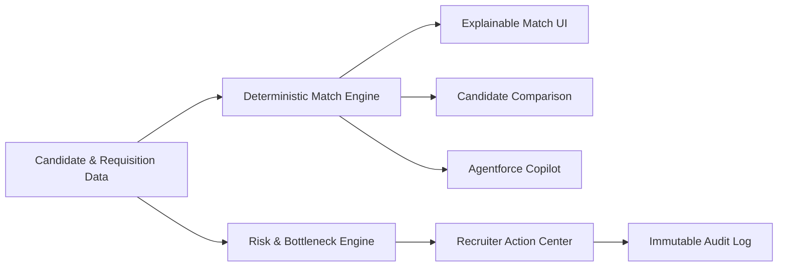
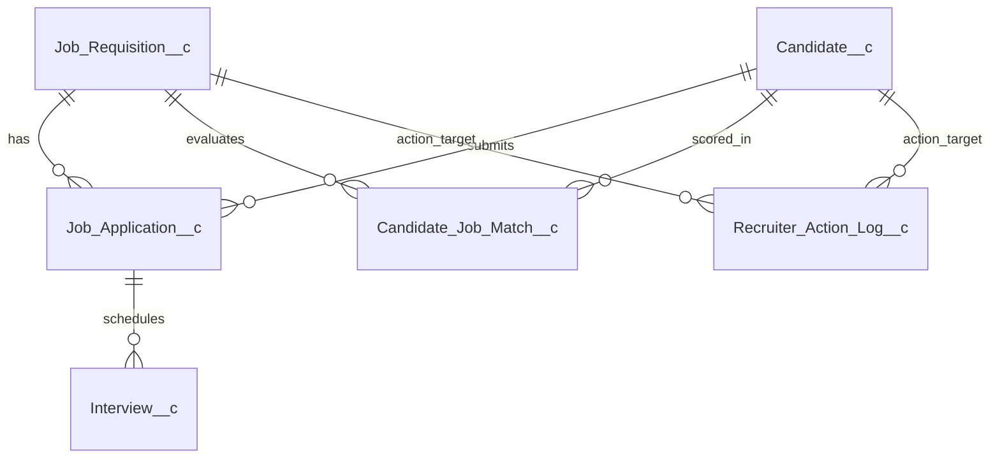

# Salesforce AI-Powered Recruitment Hub & Decision Copilot

[](https://developer.salesforce.com/)
[](https://developer.salesforce.com/)
[](docs/testing/TESTING_AND_VALIDATION.md)
[](docs/testing/TESTING_AND_VALIDATION.md)
[](docs/architecture/SYSTEM_ARCHITECTURE.md)
[](LICENSE)

An enterprise-grade, explainable AI-powered recruitment intelligence and candidate decision-support platform built on **Salesforce Lightning Platform**, **Apex**, **Lightning Web Components (LWC)**, and **Agentforce**.

---

## 🎯 Executive Summary & Problem Statement

Modern talent acquisition teams face three critical challenges:
1. **Subjective & Black-Box Candidate Screening**: Recruiters sift through hundreds of applications without explainable criteria, leading to cognitive bias and inconsistent hiring decisions.
2. **Operational Pipeline Bottlenecks**: Open requisitions stall silently in interview and screening stages without early warning signals or triage workflows.
3. **Fragmented Recruiter Tooling**: Talent leaders lack a single pane of glass connecting raw candidate profiles, algorithmic fit diagnostics, conversational AI assistance, and auditable recruiter actions.

### The Solution: AI Recruitment Hub
The **Salesforce AI Recruitment Hub** delivers a fully auditable, deterministic, and explainable decision-support copilot within Salesforce CRM. The platform combines a 4-factor matching algorithm, side-by-side multi-candidate comparison, autonomous Agentforce copilot assistance, operational bottleneck detection, and a human-in-the-loop action center.

---

## ⚡ Core Platform Capabilities



### 1. Explainable Match Intelligence (Phase 1 & 2)
- **Single Source of Truth**: Algorithmic scoring executed exclusively in [`CandidateJobMatchService.cls`](force-app/main/default/classes/CandidateJobMatchService.cls) and stored in [`Candidate_Job_Match__c`](force-app/main/default/objects/Candidate_Job_Match__c).
- **Explainable 4-Factor Formula**:
  - 🛠️ **Skills Match (50%)**: Jaccard token overlap between candidate skills and role requirements.
  - ⏳ **Experience Match (25%)**: Ratio of candidate career tenure against required threshold.
  - 🎓 **Qualification Match (15%)**: Educational hierarchy alignment (Doctorate $\ge$ Master's $\ge$ Bachelor's).
  - 📍 **Location Match (10%)**: Geographic proximity and remote eligibility matching.
- **Explainability Artifacts**: Generates explicit positive rationales (`Match_Reasons__c`) and shortfall diagnostics (`Gap_Analysis__c`) rendered in the reactive [`candidateJobMatchPanel`](force-app/main/default/lwc/candidateJobMatchPanel) LWC.

### 2. Multi-Candidate Comparison Engine (Phase 3)
- Enables recruiters to select **2 to 5 candidates** for any job opening and generate side-by-side multi-dimensional comparative matrices via [`candidateComparisonPanel`](force-app/main/default/lwc/candidateComparisonPanel).
- Compares normalized factor scores, cross-candidate skill overlap matrices, and relative strengths without black-box ranking.

### 3. Agentforce Recruitment Decision Copilot (Phase 4A)
- Conversational AI powered by Salesforce Agentforce (`AI_Recruitment_Assistant.agent`).
- Grounded via custom Invocable Apex actions (`CandidateJobMatchAction`, `CandidateComparisonAction`, `RecruitmentPipelineSummaryAction`, `RecruitmentRiskAction`, `RecruitmentAlertAction`).
- Natural language query examples:
  - *"How well does Jane Doe match the Senior Salesforce Architect role?"*
  - *"Compare candidates Jane Doe and John Smith for the Engineering Manager requisition."*
- **Strictly Grounded**: Never invents or recalculates scores—strictly consumes verified `Candidate_Job_Match__c` records.

### 4. Recruitment Intelligence & Pipeline Analytics (Phase 4B)
- Enterprise dashboard ([`recruitmentIntelligenceDashboard`](force-app/main/default/lwc/recruitmentIntelligenceDashboard) & [`recruitmentHomeDashboard`](force-app/main/default/lwc/recruitmentHomeDashboard)) visualizing:
  - Overall pipeline stage velocity and applicant progression.
  - Requisition coverage ratios and talent deficits.
  - Departmental hiring throughput.

### 5. Risk & Bottleneck Intelligence (Phase 5)
- Deterministic background detection driven by `Recruitment_Alert_Threshold__mdt`:
  - ⚠️ **Stalled Applications**: Candidates stationary in a stage for $>14$ calendar days.
  - ⚠️ **Unscheduled Interviews**: Qualified applicants awaiting interview scheduling for $>5$ days.
  - ⚠️ **Scorecard Bottlenecks**: Completed interviews lacking interviewer feedback after $>3$ business days.
  - ⚠️ **Requisition Aging Risk**: Open roles approaching target hire date with low applicant volume.
- Surfaced via [`recruitmentAttentionPanel`](force-app/main/default/lwc/recruitmentAttentionPanel) and [`recruitmentAiAssistantPanel`](force-app/main/default/lwc/recruitmentAiAssistantPanel).

### 6. Recruiter Action Center & Audit Logging (Phase 6)
- Operational workbench ([`recruiterActionCenter`](force-app/main/default/lwc/recruiterActionCenter)) allowing recruiters to triage alerts and execute one-click interventions:
  - `Nudge Interviewer`: Sends prompt reminder notifications to interviewers.
  - `Schedule Interview`: Triggers automated scheduling invitations.
  - `Source Candidates`: Escalates low-pipeline requisitions to talent sourcing.
  - `Flag Stalled Application`: Flags bottlenecked applications for hiring manager review.
- **Audit Compliance**: Every alert and intervention is tracked and logged in [`Recruitment_Alert__c`](force-app/main/default/objects/Recruitment_Alert__c).

---

## 🛡️ Responsible AI & Ethical Guardrails

1. **Human-in-the-Loop Decision Support**: The platform explicitly **prohibits autonomous hiring, rejection, or applicant advancement**. All algorithmic outputs and Agentforce recommendations serve strictly as decision support for human recruiters.
2. **Transparent & Auditable**: Match scores provide exact mathematical reasoning and skill gap analyses. Black-box opaque embeddings are not used for scoring.
3. **Data Privacy & PII Safeguards**: Role-Based Access Control masks candidate telephone and contact PII from Hiring Managers and automated Agent identities.
4. **Least Privilege Apex Architecture**: All Apex classes enforce `with sharing` and programmatic `Schema.sObjectType` CRUD/FLS validation.

---

## 🏛️ Technical Architecture & Stack

```
Salesforce AI Recruitment Hub
├── Salesforce Platform       : Spring '26 (Source API v67.0, Org API v68.0)
├── AI / Agentforce           : Agentforce Authoring Bundle (AI_Recruitment_Assistant)
├── Backend Logic             : Apex (21 Production Classes, 15 Test Classes)
├── User Interface            : Lightning Web Components (7 Custom LWCs)
├── Declarative Automation    : Salesforce Flow (8 Automated Record Flows)
├── Analytics                 : Lightning Reports (6) & Dashboard (1)
└── Security Governance       : 4 Dedicated Permission Sets, 0 Profiles Required
```

### Data Schema Overview (6 Custom Objects + 2 Metadata Types)



---

## 📂 Repository Directory Structure

```
recruitment-ai/
├── force-app/main/default/
│   ├── aiAuthoringBundles/        # Agentforce Copilot Configuration (AI_Recruitment_Assistant)
│   ├── applications/              # Lightning Application (AI_Recruitment_Hub)
│   ├── classes/                   # 36 Apex Classes (21 Production, 15 Test)
│   ├── customMetadata/            # 11 Custom Metadata Records (Weights & Thresholds)
│   ├── dashboards/                # Executive Recruitment Dashboard
│   ├── flexipages/                # Lightning Record & Home Pages
│   ├── flows/                     # 8 Automated Recruitment & Notification Flows
│   ├── layouts/                   # Standard Page Layouts
│   ├── lwc/                       # 7 Lightning Web Components
│   ├── objects/                   # 6 Custom Objects & 2 Custom Metadata Types
│   ├── permissionsets/            # 4 Role-Based Permission Sets
│   ├── reports/                   # 6 Standard Recruitment Pipeline Reports
│   ├── settings/                  # Bot Settings Metadata
│   └── tabs/                      # 11 Custom Lightning Tabs
├── docs/
│   ├── architecture/              # SYSTEM_ARCHITECTURE.md
│   ├── deployment/                # DEPLOYMENT_ARCHITECTURE.md, DEPLOYMENT_RUNBOOK.md, METADATA_INVENTORY.md
│   ├── security/                  # SECURITY_AND_ACCESS_MODEL.md
│   └── testing/                   # TESTING_AND_VALIDATION.md
├── manifest/
│   └── package.xml                # Standard Deployment Manifest (API v67.0)
├── reports/                       # Formal Phase Audit Reports (Phase 7A through 7C)
├── sfdx-project.json              # Salesforce DX Project Configuration
└── README.md                      # Project Portfolio Overview
```

---

## 🚀 Quick Start & Deployment Guide

For full deployment instructions, prerequisite configuration, and rollback strategies, see the [Deployment Runbook](docs/deployment/DEPLOYMENT_RUNBOOK.md).

### 1. Authenticate to Salesforce Org
```powershell
sf org login web --set-default --alias recruitment-dev
```

### 2. Validate Deployment (Dry-Run)
```powershell
sf project deploy validate --manifest manifest/package.xml -o recruitment-dev
```

### 3. Deploy Metadata
```powershell
sf project deploy start --manifest manifest/package.xml -o recruitment-dev
```

### 4. Assign Permission Sets
```powershell
sf org assign permset --name Recruitment_Administrator -o recruitment-dev
sf org assign permset --name Recruitment_Recruiter -o recruitment-dev
```

### 5. Seed Test Data & Run Verification
Open Developer Console > Execute Anonymous Apex:
```apex
RecruitmentTestDataFactory.createFullRecruitmentScenario();
```

Execute Apex test suite:
```powershell
sf apex run test --test-level RunLocalTests --code-coverage --result-format human -o recruitment-dev
```

---

## 🧪 Testing & Quality Assurance

- **122 / 122 Tests Passing** with zero failures.
- **92% Org-Wide Code Coverage** across all 21 production Apex classes.
- **Dedicated Security Test Suite** ([`RecruitmentSecurityTest.cls`](force-app/main/default/classes/RecruitmentSecurityTest.cls)) validating:
  - Administrator full CRUD capability.
  - Recruiter zero-delete enforcement.
  - Hiring manager PII masking (inaccessible candidate phone numbers).
  - Agentforce agent read-only and DML restriction enforcement.

---

## 🖼️ User Interface & Experience

```
+-----------------------------------------------------------------------------------+
|  AI Recruitment Hub  |  Candidates  |  Jobs  |  Match Intelligence  |  Action Center |
+-----------------------------------------------------------------------------------+
|                                                                                   |
|  [ Candidate Job Match Panel ]                     [ Risk & Bottleneck Alerts ]   |
|  +---------------------------------------+         +----------------------------+ |
|  |  Candidate: Jane Doe                  |         | ! Stalled Application (16d)| |
|  |  Requisition: Senior Architect        |         |   Jane Doe - Technical Rd  | |
|  |                                       |         |   Action: [ Nudge Panel ]  | |
|  |  OVERALL FIT: 88% [==== Score Gauge ==]         +----------------------------+ |
|  |  - Skills: 92% (Apex, LWC, Cloud)     |         | ! Interview Scorecard Lag  | |
|  |  - Experience: 85% (8/7 Years Req)    |         |   John Smith - Tech Round  | |
|  |  - Qualification: 90% (B.S. Comp Sci) |         |   Action: [ Nudge Lead ]   | |
|  |  - Location: 80% (Hybrid NYC)         |         +----------------------------+ |
|  +---------------------------------------+                                        |
|                                                                                   |
|  [ Agentforce Assistant ]                                                         |
|  > User: "Compare Jane Doe and Alex Morgan for Senior Architect opening."         |
|  > Agent: "Jane Doe demonstrates stronger skills fit (92% vs 78%), while Alex    |
|            Morgan offers 2 additional years of relevant leadership experience..." |
+-----------------------------------------------------------------------------------+
```

---

## ⚠️ Known Limitations & Enterprise Roadmap

1. **Developer Edition Org-Wide Defaults**: In the developer edition demonstration environment, custom objects use `ReadWrite` (Public Read/Write) sharing. Production environments should transition to `Private` OWD with criteria-based sharing rules per department.
2. **Dashboard Running User**: `Recruitment_Dashboard` is configured with `SpecifiedUser` to comply with Developer Edition constraints (max 3 dynamic dashboards org-wide). In enterprise orgs, convert to `LoggedInUser`.
3. **Einstein Bots Legal Terms**: `Bot.settings-meta.xml` requires manual UI acceptance of Einstein Bots legal terms prior to deployment. Excluded from `manifest/package.xml` to ensure clean automated deployments.

---

## 👤 Author & Acknowledgments

- **Platform Architect & Developer**: Shaik Afrid ([@afrid995](https://github.com/afrid995))
- **Technology Focus**: Salesforce DX, Apex Enterprise Patterns, Lightning Web Components, Agentforce AI, Responsible AI Architecture.
- **Repository**: [https://github.com/afrid995/salesforce-ai-recruitment-hub](https://github.com/afrid995/salesforce-ai-recruitment-hub)
