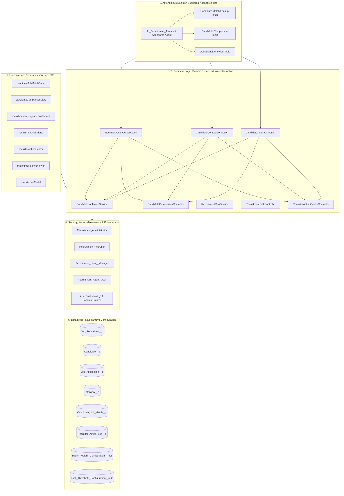
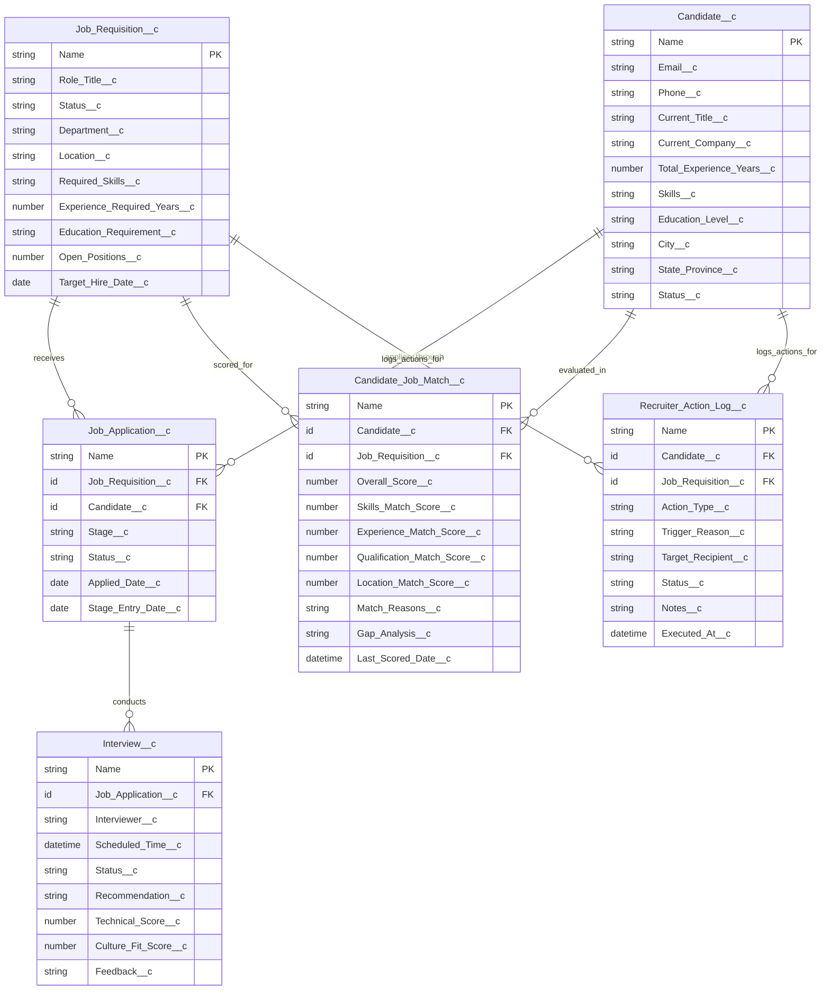
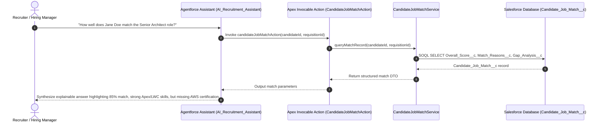

# Salesforce AI Recruitment Hub — System Architecture & Technical Specifications

> **System Overview**: An enterprise-grade, explainable AI-powered recruitment intelligence and candidate decision-support platform built on Salesforce DX, Service Cloud / Lightning Platform, and Agentforce.

---

## 1. High-Level Architectural Tiers

The Salesforce AI Recruitment Hub is architected into five decoupled, deterministic, and auditable tiers:

---

## 2. Data Model & Entity Relationship (ERD)

The data tier consists of 6 custom objects and 2 custom metadata types, establishing referential integrity, historical tracking, and deterministic rule configurations.

### Core Objects Specifications

1. [`Job_Requisition__c`](../../force-app/main/default/objects/Job_Requisition__c/Job_Requisition__c.object-meta.xml):
   - Represents an approved job opening.
   - Master entity for matching intelligence, coverage analysis, and risk identification.
2. [`Candidate__c`](../../force-app/main/default/objects/Candidate__c/Candidate__c.object-meta.xml):
   - Represents candidate profile data, including skills, verified experience, education level, and geographic residence.
   - Sensitive PII fields (such as `Phone__c`) are governed by strict Field-Level Security (FLS).
3. [`Job_Application__c`](../../force-app/main/default/objects/Job_Application__c/Job_Application__c.object-meta.xml):
   - Junction tracking candidate progression across recruitment pipeline stages (`Screening`, `Technical Interview`, `Hiring Manager Review`, `Offer`, `Closed`).
   - Tracks `Stage_Entry_Date__c` to enable deterministic pipeline velocity and stall detection.
4. [`Interview__c`](../../force-app/main/default/objects/Interview__c/Interview__c.object-meta.xml):
   - Represents interview events linked to applications.
   - Stores interviewer evaluation, scorecard dimensions, scheduling timestamps, and completion statuses.
5. [`Candidate_Job_Match__c`](../../force-app/main/default/objects/Candidate_Job_Match__c/Candidate_Job_Match__c.object-meta.xml):
   - **The Single Source of Truth** for candidate matching intelligence.
   - Pre-computed, immutable match score breakdowns, skill intersection sets, gap diagnostics, and recalculation timestamps.
6. [`Recruiter_Action_Log__c`](../../force-app/main/default/objects/Recruiter_Action_Log__c/Recruiter_Action_Log__c.object-meta.xml):
   - Audit trail capturing all operational actions executed by recruiters via the Recruiter Action Center (nudge interviewer, request interview scheduling, source talent, flag stalled application).

---

## 3. Explainable Match Intelligence Engine

### Authoritative Architecture Principle
- **Single Source of Truth**: All match scoring, factor evaluation, and gap analyses are executed strictly within [`CandidateJobMatchService.cls`](../../force-app/main/default/classes/CandidateJobMatchService.cls).
- Neither Agentforce agents, LWC components, nor external services are permitted to re-score or invent scores. All consumers read existing `Candidate_Job_Match__c` records.

### Mathematical Formulation
The overall candidate score $S_{total} \in [0, 100]$ is computed as a weighted linear combination of four explainable sub-factors configured in `Match_Weight_Configuration__mdt`:

$$S_{total} = (W_{skill} \times S_{skill}) + (W_{exp} \times S_{exp}) + (W_{qual} \times S_{qual}) + (W_{loc} \times S_{loc})$$

| Component | Default Weight ($W$) | Scoring Metric & Algorithm |
| :--- | :--- | :--- |
| **Skills Match** ($S_{skill}$) | **50%** (0.50) | Jaccard overlap of candidate skill tokens vs requisition required skills list. |
| **Experience Match** ($S_{exp}$) | **25%** (0.25) | Ratio of candidate total experience years against requisition required experience years (capped at 100%). |
| **Qualification Match** ($S_{qual}$) | **15%** (0.15) | Hierarchy tier matching between candidate education level and requisition requirement (Doctorate $\ge$ Master's $\ge$ Bachelor's $\ge$ Associate's). |
| **Location Match** ($S_{loc}$) | **10%** (0.10) | Exact geographic match (City/State), remote eligibility status, or regional compatibility. |

### Explainability Artifacts
For every evaluation, the engine generates:
1. `Match_Reasons__c`: Explicit positive rationale detailing matched skills and years above baseline.
2. `Gap_Analysis__c`: Explicit gap rationale detailing missing required skills, experience shortfall, or credential mismatch.

---

## 4. Candidate Comparison Intelligence

The comparison engine allows recruiters to select between 2 and 5 candidates for any job requisition and perform side-by-side multi-dimensional comparative analysis:
- **Backend Service**: [`CandidateComparisonController.cls`](../../force-app/main/default/classes/CandidateComparisonController.cls).
- **Invocable Action**: [`CandidateComparisonAction.cls`](../../force-app/main/default/classes/CandidateComparisonAction.cls).
- **UI Component**: [`candidateComparisonView`](../../force-app/main/default/lwc/candidateComparisonView/candidateComparisonView.js).
- **Core Functionality**:
  - Comparative ranking matrix across Overall, Skill, Experience, Qualification, and Location scores.
  - Normalized side-by-side skill gap matrices.
  - Human decision-support summary highlighting relative strengths and weaknesses without autonomous decision-making.

---

## 5. Agentforce Decision Copilot (`AI_Recruitment_Assistant`)

The platform integrates Salesforce Agentforce to provide conversational decision support directly to recruiters.

### Agentforce Configuration Specifications
- **Agent Authoring Bundle**: `force-app/main/default/aiAuthoringBundles/AI_Recruitment_Assistant.agent`
- **Agent Type**: Customer / Employee Service Copilot.
- **Topics**:
  - `General_Recruitment`: Contextual assistance on job requisition status and candidate pipelines.
  - `Candidate_Matching`: Grounded lookup of candidate fit via `CandidateJobMatchAction`.
  - `Candidate_Comparison`: Side-by-side comparative analysis via `CandidateComparisonAction`.
- **Responsible AI Principles**:
  - Strictly decision-support.
  - Zero autonomous candidate rejection, promotion, or hiring.
  - Every recommendation cites stored deterministic match data.

---

## 6. Recruitment Risk & Bottleneck Intelligence

Deterministic detection of operational vulnerabilities across recruitment pipelines:
- **Service**: [`RecruitmentRiskService.cls`](../../force-app/main/default/classes/RecruitmentRiskService.cls).
- **Configuration**: `Risk_Threshold_Configuration__mdt`.
- **Deterministic Alert Categories**:
  1. **Stalled Application**: Application has remained in its current stage $>14$ calendar days without activity.
  2. **Unscheduled Interview**: Application advanced to an interview stage but has no interview record scheduled $>5$ days.
  3. **Pending Feedback Bottleneck**: Interview completed $>3$ business days ago with missing feedback/recommendation.
  4. **Low Talent Pipeline**: Open requisition has $<3$ qualified candidates (overall score $\ge 70$) in pipeline.
  5. **Requisition Velocity Risk**: Requisition open for $>45$ days with target hire date approaching within 14 days.

---

## 7. Recruiter Action Center & Audit Logging

The operational bridge transforming risk signals into human-in-the-loop actions:
- **Service & Controller**: [`RecruiterActionCenterController.cls`](../../force-app/main/default/classes/RecruiterActionCenterController.cls), [`RecruiterActionService.cls`](../../force-app/main/default/classes/RecruiterActionService.cls).
- **Standardized Action Dispatch**:
  - `NUDGE_INTERVIEWER`: Sends reminder notifications to interviewers with pending scorecards.
  - `SCHEDULE_INTERVIEW`: Initiates interview scheduling workflows.
  - `SOURCE_CANDIDATES`: Flags requisitions for talent acquisition attention.
  - `FLAG_STALLED_APPLICATION`: Escalates stalled candidates to the hiring manager.
- **Auditability**: Every action creates an immutable [`Recruiter_Action_Log__c`](../../force-app/main/default/objects/Recruiter_Action_Log__c/Recruiter_Action_Log__c.object-meta.xml) record capturing actor, timestamp, action type, target recipient, and operational context.

---

## 8. Lightning Web Components Suite

| Component | Target Location | Description |
| :--- | :--- | :--- |
| [`candidateJobMatchPanel`](../../force-app/main/default/lwc/candidateJobMatchPanel) | Candidate Record Page / Application Page | Displays real-time match gauge, factor breakdown, and gap analysis. |
| [`candidateComparisonView`](../../force-app/main/default/lwc/candidateComparisonView) | Match Intelligence Tab | Side-by-side multi-candidate evaluation matrix. |
| [`recruitmentIntelligenceDashboard`](../../force-app/main/default/lwc/recruitmentIntelligenceDashboard) | Recruitment Dashboard Tab | Organization-wide recruitment pipeline health, coverage, and bottlenecks. |
| [`recruitmentRiskAlerts`](../../force-app/main/default/lwc/recruitmentRiskAlerts) | Home Page / Dashboard | Visual cards displaying high/medium severity operational risks. |
| [`recruiterActionCenter`](../../force-app/main/default/lwc/recruiterActionCenter) | Recruiter Action Center Tab | Interactive workbench for triaging alerts and executing actions. |
| [`matchIntelligenceViewer`](../../force-app/main/default/lwc/matchIntelligenceViewer) | Job Requisition Page | Shows matched candidate pool ranked by fit with quick comparison launcher. |
| [`quickActionModal`](../../force-app/main/default/lwc/quickActionModal) | Global / Sub-component | Reusable modal dialog for confirming actions with custom notes. |
