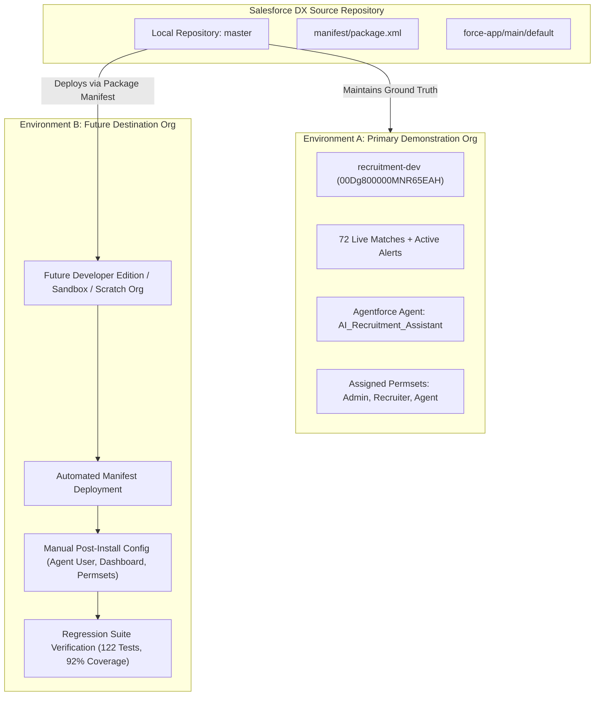
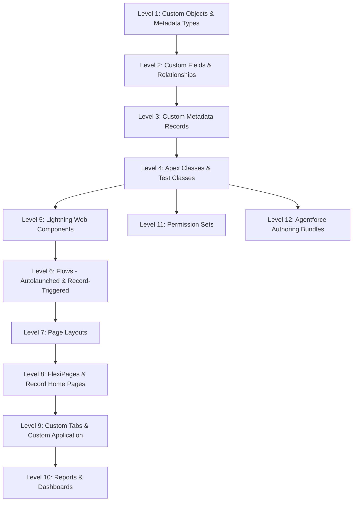

# Deployment Architecture
## Salesforce AI-Powered Recruitment Intelligence & Candidate Decision-Support Platform

---

## 1. Project Overview

The **Salesforce AI Recruitment Hub** is an enterprise-grade recruitment decision-support platform built on the Salesforce Platform using Salesforce DX. It augments recruitment operations with:
- Deterministic, explainable candidate-to-job matching intelligence across Skills (50%), Experience (25%), Qualification (15%), and Location (10%).
- Multi-candidate side-by-side comparison with skill gap matrix visualization.
- Autonomous operational risk detection and recruiter bottleneck signaling.
- Recruiter Action Center providing human-in-the-loop alert triage and interview rescheduling.
- Agentforce-powered conversational recruitment copilot for real-time candidate search, matching lookup, and job requisition queries.
- Granular Role-Based Access Control (RBAC) enforcing candidate Personally Identifiable Information (PII) masking and least-privilege operations.

---

## 2. Deployment Objectives

1. **Demonstration Environment Integrity**: Maintain the primary Developer Edition demonstration org (`recruitment-dev`) with intact candidate records, evaluated match scores, active Agentforce bot configurations, and verified regression test suites.
2. **Reproducible Destination Deployment**: Provide a deterministic, dependency-ordered deployment path enabling any Salesforce administrator or developer to install, configure, and validate the platform in a new target Developer Edition org or scratch org.
3. **Strict Separation of Concerns**: Decouple automated metadata deployment from manual post-deployment configurations (e.g., Agentforce activation, dashboard running-user assignment, user permission assignments).
4. **Zero Live Mutation Guarantee**: Ensure that deployment architecture preparations do not execute premature deployments, activate/deactivate live flows, modify sharing models, or push to unverified remote Git repositories.

---

## 3. Dual-Environment Strategy

### Environment A: Primary Demonstration Org (`recruitment-dev`)
- **Org ID**: `00Dg800000MNR65EAH`
- **Edition**: Developer Edition (Spring '26 / v68.0)
- **Role**: Active demonstration sandbox containing evaluated recruitment records, historical match scores, active Agentforce authoring bundles, configured tabs, and reports.
- **Maintenance Policy**: Read-only validation; no disruptive metadata deployments, no forced OWD migrations, and no schema resets.

### Environment B: Future Destination Org
- **Role**: Target Salesforce environment (Developer Edition, Sandbox, or Enterprise Org) used by third parties to reproduce and verify the platform.
- **Strategy**: Follows the dependency-ordered deployment sequence outlined in this document, utilizing `manifest/package.xml` and executing post-deployment configuration steps.

---

## 4. Metadata Dependency Architecture

Salesforce metadata components must be deployed in a strict topological order to satisfy compile-time schema dependencies:

### Dependency Levels Explained

1. **Level 1 — Schema Foundation**:
   - `Job_Requisition__c`, `Candidate__c`, `Job_Application__c`, `Interview__c`, `Candidate_Job_Match__c`, `Recruitment_Alert__c`.
   - `Match_Weight_Configuration__mdt`, `Recruitment_Alert_Threshold__mdt`.
2. **Level 2 — Schema Fields & Relationships**:
   - 91 custom fields, including master-detail / lookup relationships (`Candidate__c`, `Job_Requisition__c`) and unique external IDs (`Match_Key__c`, `Alert_Key__c`).
3. **Level 3 — Seed Metadata**:
   - 11 Custom Metadata records establishing baseline scoring weights (Default_Weight: 50/25/15/10) and operational alert thresholds.
4. **Level 4 — Business Logic Layer**:
   - 21 production Apex classes and 15 test classes. Depends on Custom Objects, Fields, and Custom Metadata Types.
5. **Level 5 — UI Component Layer**:
   - 7 Lightning Web Components (LWCs). Depends on Apex `@AuraEnabled` controllers and Lightning Design System (SLDS).
6. **Level 6 — Declarative Automation Layer**:
   - 8 Flows (4 record-triggered, 4 agent-invocable autolaunched flows). Depends on Objects, Fields, and status picklists.
7. **Level 7 — Page Layouts**:
   - 4 Custom Object layouts. Required before FlexiPage validation can resolve standard record detail facets.
8. **Level 8 — Lightning FlexiPages**:
   - `AI_Recruitment_Hub_Home` and `Candidate_Record_Page`. Depends on Layouts and LWCs.
9. **Level 9 — Navigation & Apps**:
   - 11 Custom Tabs and `AI_Recruitment_Hub` Custom Application.
10. **Level 10 — Analytics Layer**:
    - 6 Reports in `unfiled$public` and `Recruitment_Dashboard` in `Recruitment_Dashboards`.
11. **Level 11 — Security & Governance Layer**:
    - 4 Permission Sets (`Recruitment_Admin`, `Recruitment_Recruiter`, `Recruitment_Hiring_Manager`, `Recruitment_Agent_User`). Depends on Objects, Fields, Tabs, and Apex Classes.
12. **Level 12 — Conversational AI Layer**:
    - `AI_Recruitment_Assistant` Agentforce bundle (`.agent` and `.bundle-meta.xml`). Depends on Apex Invocable actions, Autolaunched Flows, and Agent User identity.

---

## 5. Apex and LWC Dependencies

- **Apex Controller Hierarchy**:
  - `CandidateJobMatchUIController` $\rightarrow$ calls `CandidateJobMatchService`.
  - `CandidateComparisonController` $\rightarrow$ calls `CandidateJobMatchService` and `CandidateJobMatchUIController.getWeightConfig()`.
  - `RecruitmentAlertController` $\rightarrow$ calls `RecruitmentAlertService`.
  - `RecruitmentRiskController` $\rightarrow$ calls `RecruitmentRiskService`.
  - `RecruitmentAgentChatController` $\rightarrow$ invokes Salesforce Invocable Action `generateAiAgentResponse`.
- **LWC-to-Apex Bindings**:
  - `candidateJobMatchPanel` $\rightarrow$ `CandidateJobMatchUIController`
  - `candidateComparisonPanel` $\rightarrow$ `CandidateComparisonController`
  - `recruiterActionCenter` $\rightarrow$ `RecruitmentAlertController`
  - `recruitmentAiAssistantPanel` $\rightarrow$ `RecruitmentAgentChatController`
  - `recruitmentAttentionPanel` $\rightarrow$ `RecruitmentRiskController`
  - `recruitmentHomeDashboard` $\rightarrow$ `RecruitmentHomeController`
  - `recruitmentIntelligenceDashboard` $\rightarrow$ `RecruitmentIntelligenceController`

---

## 6. Flow Dependencies and Activation Order

The 8 Flows must be deployed and activated in the following sequence:

1. **Pre-requisite Autolaunched Flows (Agent Actions)**:
   - `Recruitment_Create_Job`
   - `Recruitment_Create_Candidate`
   - `Recruitment_Create_Application`
   - `Recruitment_Update_Application`
2. **Record-Triggered Automation Flows**:
   - `New_Job_Application` (`RecordBeforeSave` on `Job_Application__c`)
   - `Application_Shortlisted` (`RecordAfterSave` on `Job_Application__c`)
   - `Candidate_Selected` (`RecordAfterSave` on `Job_Application__c`)
   - `Interview_Completed` (`RecordAfterSave` on `Interview__c`)

---

## 7. Permission Set Deployment & Assignment Requirements

| Permission Set | Target Persona | Deployment Timing | Post-Deploy Assignment Action |
| :--- | :--- | :--- | :--- |
| **`Recruitment_Admin`** | System Administrators | Level 11 | Assign to deployment administrator. |
| **`Recruitment_Recruiter`** | Talent Acquisition Specialists | Level 11 | Assign to standard recruiters (no delete rights). |
| **`Recruitment_Hiring_Manager`** | Department Hiring Managers | Level 11 | Assign to managers (phone PII masked, read-only except feedback). |
| **`Recruitment_Agent_User`** | Agentforce Bot Execution User | Level 11 | Assign to destination org Agent User identity. |

---

## 8. Agentforce Setup Dependencies

1. **Target Org Prerequisite**: Destination org must have **Agentforce enabled** in Setup > Agentforce.
2. **Agent Execution User**: When Agentforce is enabled, Salesforce creates a dedicated Agent User with a random username suffix (e.g., `agent.user.<hash>@agentforce.com`).
3. **Metadata Remapping**: In a new org, `AI_Recruitment_Assistant.agent` line 13 (`default_agent_user`) must be remapped to the destination org's actual Agent User username prior to publishing.
4. **Publishing**: The agent must be explicitly published via Setup > Agentforce or the Agentforce authoring bundle interface.

---

## 9. Dashboard and Report Dependencies

1. **Report Folder**: Reports must be deployed to `unfiled$public` (Public Reports).
2. **Dashboard Folder**: `Recruitment_Dashboards-meta.xml` must be deployed before `Recruitment_Dashboard.dashboard-meta.xml`.
3. **Running User Portability**: `Recruitment_Dashboard` specifies running user `skafrid246.bd97a9cd1a82@agentforce.com`.
   - *In Demonstration Org*: Retained for single-org stability.
   - *In Destination Org*: Must be remapped to the destination org administrator username, or converted to a Dynamic Dashboard (`LoggedInUser`) if the destination org edition permits.

---

## 10. Environment-Specific Configuration & Exclusions

### 1. `Bot.settings-meta.xml`
- **Issue**: Deploying `BotSettings` via Metadata API fails with `Deploying BotSettings require accepting the Einstein Bots Legal Terms first.`
- **Architecture Strategy**: Exclude `Bot.settings-meta.xml` from automated manifest deployments. Modern Agentforce uses `aiAuthoringBundles` and does not require legacy Bot settings.

### 2. `Candidate_Record_Page.flexipage-meta.xml`
- **Issue**: Dry-run deployments fail with `Component [flexipage:detail] is not available for design time` if layouts are not yet assigned or compiled.
- **Architecture Strategy**: Deploy `layouts/` first. If deploying the FlexiPage in a standalone dry-run fails, activate the FlexiPage manually via Lightning App Builder post-install.

---

## 11. Rollback & Recovery Approach

1. **Version Control Rollback**: Git checkpoint tags allow instant reversion of local source code to a verified state (`git checkout <tag>`).
2. **Metadata Re-deployment**: Re-deploying previous metadata replaces Apex, LWCs, and Flows.
3. **Destructive Changes**: In Salesforce Metadata API, deleting fields or objects requires an explicit `destructiveChanges.xml` manifest. Automated rollbacks do not delete schema fields or customer data.
4. **Data Protection Guarantee**: Schema rollbacks never recover deleted records. Deletion permissions are strictly restricted to Administrators to prevent data loss.

---

## 12. Known Limitations

1. **Organization-Wide Defaults (OWD)**: Custom objects currently operate under `Public Read/Write`. Database-level row isolation for hiring managers requires migrating OWD to `Private` with sharing rules prior to enterprise production deployment.
2. **Dynamic Dashboard Edition Limits**: Developer Edition orgs support a maximum of 3 dynamic dashboards. `Recruitment_Dashboard` uses `SpecifiedUser` to prevent consuming org limits.
