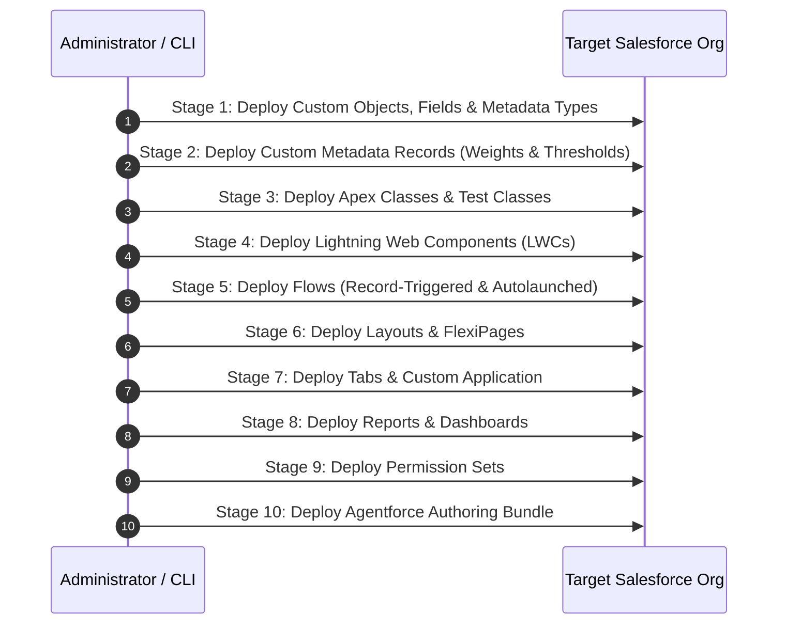

# Reproducible Deployment Runbook
## Salesforce AI-Powered Recruitment Intelligence & Candidate Decision-Support Platform

> **Notice**: This document provides step-by-step instructions for deploying the Salesforce AI Recruitment Hub into a target Salesforce environment (e.g., a new Developer Edition org or Sandbox).  
> **Phase 7C Status**: This runbook has been verified via dependency analysis and static inspection; it has **not** been executed as an active deployment during Phase 7C.

---

## 1. Prerequisites

Before initiating deployment, ensure the target environment and local machine satisfy the following:

1. **Local Developer Tools**:
   - **Salesforce CLI**: Version `2.153.0` or higher (`sf --version`).
   - **Node.js**: Version `18.x`, `20.x`, or `22.x`.
   - **Git**: Version `2.30+`.
   - **VS Code**: With Salesforce Extension Pack (recommended).
2. **Target Salesforce Org Requirements**:
   - **Org Type**: Developer Edition org (recommended for portfolio evaluation) or Sandbox.
   - **Platform Features Enabled**:
     - *Agentforce*: Setup > Agentforce > Enable Agentforce (Required for AI copilot capabilities).
     - *Lightning Experience*: Enabled (Standard in modern orgs).
   - **User Licenses**: At least 1 System Administrator license and 1 standard user license.

---

## 2. Authentication

Authenticate your target Salesforce organization using the Salesforce CLI web login flow.  
*Never store or commit access tokens or client secrets.*

```bash
# Authorize the target org and assign an alias (e.g., recruitment-target)
sf org login web --set-default --alias recruitment-target

# Verify connected status and retrieve Org ID
sf org display --target-org recruitment-target
```

---

## 3. Project Setup

1. **Clone the Repository**:
   ```bash
   git clone <repository-url> recruitment-ai
   cd recruitment-ai
   ```
2. **Verify Project Structure**:
   Ensure `sfdx-project.json`, `manifest/package.xml`, and `force-app/` are present.
3. **Verify Git Baseline**:
   ```bash
   git status
   git branch --show-current
   ```

---

## 4. Dependency-Aware Deployment Sequence

Because metadata components have strict compile-time dependencies, follow the staged deployment sequence below:



### Option A: Automated Manifest Deployment (Recommended)
Deploy all verified components using `manifest/package.xml`:

```bash
sf project deploy start \
  --manifest manifest/package.xml \
  --target-org recruitment-target \
  --wait 30
```

### Option B: Staged Deployment (For Granular Troubleshooting)

#### Stage 1: Core Schema & Custom Metadata Types
```bash
sf project deploy start \
  --source-dir force-app/main/default/objects \
  --target-org recruitment-target
```

#### Stage 2: Custom Metadata Records
```bash
sf project deploy start \
  --source-dir force-app/main/default/customMetadata \
  --target-org recruitment-target
```

#### Stage 3: Apex Classes & Services
```bash
sf project deploy start \
  --source-dir force-app/main/default/classes \
  --target-org recruitment-target
```

#### Stage 4: Lightning Web Components
```bash
sf project deploy start \
  --source-dir force-app/main/default/lwc \
  --target-org recruitment-target
```

#### Stage 5: Flows
```bash
sf project deploy start \
  --source-dir force-app/main/default/flows \
  --target-org recruitment-target
```

#### Stage 6: Layouts, FlexiPages, Tabs & Applications
```bash
sf project deploy start \
  --source-dir force-app/main/default/layouts \
  --source-dir force-app/main/default/flexipages \
  --source-dir force-app/main/default/tabs \
  --source-dir force-app/main/default/applications \
  --target-org recruitment-target
```

#### Stage 7: Reports & Dashboards
```bash
sf project deploy start \
  --source-dir force-app/main/default/reports \
  --source-dir force-app/main/default/dashboards \
  --target-org recruitment-target
```

#### Stage 8: Permission Sets
```bash
sf project deploy start \
  --source-dir force-app/main/default/permissionsets \
  --target-org recruitment-target
```

#### Stage 9: Agentforce Bundle
```bash
sf project deploy start \
  --source-dir force-app/main/default/aiAuthoringBundles \
  --target-org recruitment-target
```

---

## 5. Post-Deployment Configuration

Following metadata deployment, execute the following manual administrator configurations:

### 1. Assign Administrator Permission Set
Assign `Recruitment_Admin` to your administrator account:
```bash
sf org assign permset \
  --name Recruitment_Admin \
  --target-org recruitment-target
```

### 2. Configure Agentforce Execution User
1. Navigate to **Setup > Agentforce > Agents**.
2. Locate the automatically created Agent User (e.g., `agent.user.<hash>@agentforce.com`).
3. Assign the `Recruitment_Agent_User` permission set to this agent identity:
   ```bash
   sf org assign permset \
     --name Recruitment_Agent_User \
     --on-behalf-of <agent-user-username> \
     --target-org recruitment-target
   ```
4. Open the `AI_Recruitment_Assistant` agent in the Agentforce Builder.
5. Review the assigned Topics and Actions, then click **Activate**.

### 3. Activate Flows
Navigate to **Setup > Process Automation > Flows** and verify all 8 Flows are active:
- `New_Job_Application`
- `Application_Shortlisted`
- `Candidate_Selected`
- `Interview_Completed`
- `Recruitment_Create_Application`
- `Recruitment_Create_Candidate`
- `Recruitment_Create_Job`
- `Recruitment_Update_Application`

### 4. Remap Dashboard Running User
1. Navigate to **Dashboards > Recruitment Dashboards > Recruitment Dashboard**.
2. Click **Edit > Dashboard Properties (Gear Icon)**.
3. In **View Dashboard As**, change the running user from `skafrid246.bd97a9cd1a82@agentforce.com` to your target org administrator user.
4. Save the dashboard.

### 5. Activate Candidate Record Page
1. Navigate to **Setup > Object Manager > Candidate > Lightning Record Pages**.
2. Open **Candidate Record Page** in Lightning App Builder.
3. Click **Activation... > Set as Org Default > Assign desktop & phone > Save**.

---

## 6. Post-Deployment Validation

Execute the automated test suite to confirm operational health:

```bash
# Run all local Apex tests and calculate code coverage
sf apex run test \
  --test-level RunLocalTests \
  --code-coverage \
  --result-format human \
  --target-org recruitment-target
```

**Expected Baseline**:
- **Tests Passed**: $\ge 122$ tests passed (100% pass rate).
- **Failures**: 0 failures.
- **Org-Wide Coverage**: $\ge 90\%$.

### Functional Validation Checklist:
- [ ] Open **App Launcher > AI Recruitment Hub**.
- [ ] Verify tabs: Job Requisitions, Candidates, Applications, Interviews, Match Intelligence, Candidate Comparison, Recruitment Intelligence, Recruiter Action Center.
- [ ] Test Candidate-Job Match Intelligence: Select an active job, verify radial gauge score calculation and explainable factor breakdown.
- [ ] Test Candidate Comparison: Compare 2 to 5 candidates; verify cross-candidate skill matrix renders.
- [ ] Test Recruiter Action Center: Verify active alerts load and acknowledgment modal records recruiter notes.
- [ ] Test PII Masking: Log in as a user with `Recruitment_Hiring_Manager` and verify candidate phone displays `'[Protected - Contact Recruiter]'`.

---

## 7. Rollback Strategy

If deployment must be reverted:

1. **Local Git Rollback**:
   ```bash
   git checkout master
   git clean -fd
   ```
2. **Metadata Removal**:
   To remove metadata from the org, deploy an explicit destructive changes manifest (`destructiveChanges.xml`):
   ```bash
   sf project deploy start \
     --manifest manifest/destructiveChanges.xml \
     --post-destructive-changes manifest/destructiveChanges.xml \
     --target-org recruitment-target
   ```
3. **Data Loss Caveat**:
   *Caution*: Reverting metadata does not restore deleted candidate records or match evaluations. Always take a full data backup before running destructive operations.
