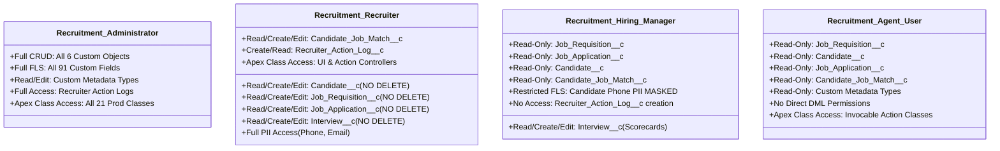
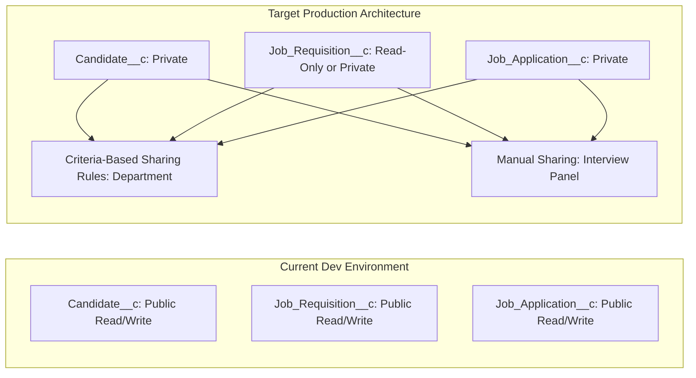

# Salesforce AI Recruitment Hub — Security & Access Model

> **Security Mandate**: Ensure multi-layered data protection, least-privilege role-based access control (RBAC), field-level PII safeguarding, strict Apex sharing enforcement, and complete audit logging across all automated and human recruitment workflows.

---

## 1. Role-Based Access Control (RBAC) Architecture

The platform defines four specialized Permission Sets aligned with operational job functions. No custom profiles are required, following Salesforce Well-Architected modern authorization standards.



### Detailed Permission Set Specifications

#### 1. [`Recruitment_Administrator`](file:///c:/Users/Shaik%20Afrid/recruitment-ai/force-app/main/default/permissionsets/Recruitment_Administrator.permissionset-meta.xml)
- **Target Persona**: System Administrators, Talent Operations Leads.
- **Permissions**:
  - Full CRUD on all 6 custom objects: `Job_Requisition__c`, `Candidate__c`, `Job_Application__c`, `Interview__c`, `Candidate_Job_Match__c`, `Recruiter_Action_Log__c`.
  - Full FLS across all 91 custom fields.
  - Read/Write access to Custom Metadata configurations (`Match_Weight_Configuration__mdt`, `Risk_Threshold_Configuration__mdt`).
  - Access to all 21 production Apex classes and management utilities.

#### 2. [`Recruitment_Recruiter`](file:///c:/Users/Shaik%20Afrid/recruitment-ai/force-app/main/default/permissionsets/Recruitment_Recruiter.permissionset-meta.xml)
- **Target Persona**: In-house Recruiters, Talent Acquisition Specialists.
- **Permissions**:
  - Read, Create, Edit on core objects (`Candidate__c`, `Job_Requisition__c`, `Job_Application__c`, `Interview__c`).
  - **Zero Delete Permissions**: Hardened during Phase 7B.1 to prevent accidental data destruction. Record lifecycle termination is reserved for Administrators.
  - Full FLS access to candidate contact info (`Email__c`, `Phone__c`) for outreach.
  - Read-Only access to Custom Metadata.
  - Create and Read on `Recruiter_Action_Log__c` to execute actions via the Recruiter Action Center.

#### 3. [`Recruitment_Hiring_Manager`](file:///c:/Users/Shaik%20Afrid/recruitment-ai/force-app/main/default/permissionsets/Recruitment_Hiring_Manager.permissionset-meta.xml)
- **Target Persona**: Department Managers, Interview Panel Leads.
- **Permissions**:
  - Read-Only on `Candidate__c`, `Job_Requisition__c`, and `Job_Application__c`.
  - Read, Create, Edit on `Interview__c` to submit interview scorecards and feedback.
  - Read-Only on `Candidate_Job_Match__c` to review match reasoning and candidate comparisons.
  - **PII Protection**: Field-Level Security removes visibility to candidate personal telephone numbers (`Candidate__c.Phone__c`), preserving privacy until direct interview contact is authorized.

#### 4. [`Recruitment_Agent_User`](file:///c:/Users/Shaik%20Afrid/recruitment-ai/force-app/main/default/permissionsets/Recruitment_Agent_User.permissionset-meta.xml)
- **Target Persona**: Dedicated Agentforce execution identity (`agent.user.<hash>@agentforce.com`).
- **Permissions**:
  - Read-Only access to matching intelligence and requisitions.
  - Execution authorization for invocable Apex classes: `CandidateJobMatchAction`, `CandidateComparisonAction`, and `RecruiterActionCenterAction`.
  - Strictly non-destructive; unable to execute direct DML on core recruitment records.

---

## 2. Field-Level Security (FLS) & Data Protection Matrix

| Object | Field API Name | Data Sensitivity | Recruitment_Admin | Recruitment_Recruiter | Recruitment_Hiring_Manager | Recruitment_Agent_User |
| :--- | :--- | :--- | :---: | :---: | :---: | :---: |
| `Candidate__c` | `Phone__c` | **PII (Restricted)** | Read/Edit | Read/Edit | **No Access** | **No Access** |
| `Candidate__c` | `Email__c` | **PII (Standard)** | Read/Edit | Read/Edit | Read-Only | Read-Only |
| `Candidate__c` | `Skills__c` | Operational | Read/Edit | Read/Edit | Read-Only | Read-Only |
| `Candidate__c` | `Total_Experience_Years__c` | Operational | Read/Edit | Read/Edit | Read-Only | Read-Only |
| `Candidate_Job_Match__c` | `Overall_Score__c` | AI Intelligence | Read/Edit | Read-Only | Read-Only | Read-Only |
| `Candidate_Job_Match__c` | `Match_Reasons__c` | AI Intelligence | Read/Edit | Read-Only | Read-Only | Read-Only |
| `Candidate_Job_Match__c` | `Gap_Analysis__c` | AI Intelligence | Read/Edit | Read-Only | Read-Only | Read-Only |
| `Interview__c` | `Feedback__c` | Evaluative | Read/Edit | Read/Edit | Read/Edit | **No Access** |
| `Recruiter_Action_Log__c` | `Executed_At__c` | Compliance Audit | Read-Only | Read-Only | **No Access** | **No Access** |

---

## 3. Apex Security & Enforcement Standards

All 21 production Apex classes implement strict programmatic security controls:

### A. Strict Sharing Keyword Enforcement
Every production class explicitly declares `with sharing` to enforce the calling user's record-level sharing rules:
```apex
public with sharing class CandidateJobMatchService { ... }
public with sharing class CandidateComparisonController { ... }
public with sharing class RecruiterActionCenterController { ... }
```

### B. Programmatic Schema Validation (CRUD/FLS Checks)
Prior to performing any SOQL query or DML operation, service methods verify user permissions:
```apex
// Object-Level Verification
if (!Schema.sObjectType.Recruiter_Action_Log__c.isCreateable()) {
    throw new SecurityException('Insufficient permissions to create Recruiter Action Log.');
}

// Field-Level Verification
if (!Schema.sObjectType.Candidate__c.fields.Phone__c.isAccessible()) {
    // Gracefully omit sensitive field or return masked placeholder
}
```

### C. Invocable Action Guardrails
Invocable actions invoked by Agentforce (`CandidateJobMatchAction`, `CandidateComparisonAction`) validate record access before formatting responses, preventing prompt injection or unauthorized record leakage.

---

## 4. Org-Wide Sharing Defaults (OWD) & Governance Strategy

### Current Configuration (Developer Edition Org Baseline)
In the current development environment (`recruitment-dev`), all 6 custom objects are configured with:
- **Internal Sharing Model**: `ReadWrite` (Public Read/Write)
- **External Sharing Model**: `Private`



### Production Security Remediation Roadmap
For enterprise multi-tenant or multi-department deployments, the following architecture is specified:
1. **Transition OWD to `Private`**: Set `Candidate__c`, `Job_Requisition__c`, and `Job_Application__c` to Private.
2. **Criteria-Based Sharing Rules**: Grant Hiring Managers access only to `Job_Requisition__c` records where `Department__c` matches their assigned organizational unit.
3. **Apex Managed Sharing / Team Membership**: Automatically grant interviewers access to candidate applications when assigned to an active `Interview__c` record.

---

## 5. Audit Logging & Compliance Architecture

The platform guarantees compliance, traceability, and human accountability:
- **Zero Autonomous Execution**: Agentforce cannot unilaterally advance, reject, or hire candidates.
- **Immutable Action Ledger**: Any outreach, nudge, or status flag triggered from the Recruiter Action Center persists an immutable entry in [`Recruiter_Action_Log__c`](file:///c:/Users/Shaik%20Afrid/recruitment-ai/force-app/main/default/objects/Recruiter_Action_Log__c).
- **Execution Metadata Captured**:
  - `Action_Type__c`: Standardized action enumeration (`NUDGE_INTERVIEWER`, `SCHEDULE_INTERVIEW`, `SOURCE_CANDIDATES`, `FLAG_STALLED_APPLICATION`).
  - `Trigger_Reason__c`: Specific bottleneck condition that prompted recruiter intervention.
  - `Target_Recipient__c`: Contact or user ID receiving the communication.
  - `Executed_At__c`: Immutable system timestamp.
  - `Notes__c`: Recruiter rationale entered during action dispatch.
