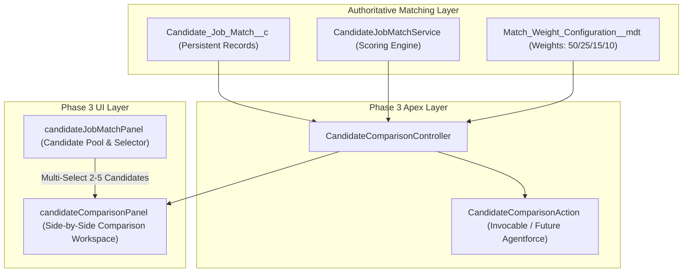

# Phase 3: Candidate Comparison Intelligence Report

> **Decision-Support Guardrail**: *"This feature compares algorithmic match evidence. It does not make or automate hiring decisions."*

---

## 1. Objective & Executive Summary

Phase 3 introduces **Candidate Comparison Intelligence** to the Salesforce AI Recruitment Hub platform (`recruitment-dev`, Org ID: `00Dg800000MNR65EAH`). 

This capability allows recruiters to select between **2 and 5 candidates** for any active Job Requisition and compare them side-by-side using existing [`Candidate_Job_Match__c`](file:///c:/Users/Shaik%20Afrid/recruitment-ai/force-app/main/default/objects/Candidate_Job_Match__c/Candidate_Job_Match__c.object-meta.xml) evaluations as the authoritative single source of truth.

### Key Tenets & Guardrails
- **Zero Duplicate Scoring**: Reuses [`CandidateJobMatchService`](file:///c:/Users/Shaik%20Afrid/recruitment-ai/force-app/main/default/classes/CandidateJobMatchService.cls) and [`Candidate_Job_Match__c`](file:///c:/Users/Shaik%20Afrid/recruitment-ai/force-app/main/default/objects/Candidate_Job_Match__c/Candidate_Job_Match__c.object-meta.xml) exclusively. No client-side recalculation or duplicate algorithm.
- **Informational Metric Only**: Highest overall score is labeled **"Highest Match Score"** (strictly never "Best Candidate", "Recommended Hire", "Best Fit", or "Predicted Hire").
- **Tied Scores Handled Transparently**: If multiple candidates share the highest score, both are recognized without forcing a winner.
- **Human-in-the-Loop Governance**: The system never selects, rejects, shortlists, or modifies `Job_Application__c.Application_Status__c` or `Candidate__c` status.
- **Strict Ethical AI**: Evaluates only explicit job-relevant competencies, experience, education, and location. Protected characteristics (age, gender, race, religion, disability, marital status) are never used or exposed.

---

## 2. Architecture & Data Model



### Data Model Employed
- **[`Job_Requisition__c`](file:///c:/Users/Shaik%20Afrid/recruitment-ai/force-app/main/default/objects/Job_Requisition__c/Job_Requisition__c.object-meta.xml)**: Provides role context, required experience, qualification tier, and required skills.
- **[`Candidate__c`](file:///c:/Users/Shaik%20Afrid/recruitment-ai/force-app/main/default/objects/Candidate__c/Candidate__c.object-meta.xml)**: Provides candidate profile evidence (experience, education, location, verified competencies).
- **[`Candidate_Job_Match__c`](file:///c:/Users/Shaik%20Afrid/recruitment-ai/force-app/main/default/objects/Candidate_Job_Match__c/Candidate_Job_Match__c.object-meta.xml)**: Authoritative evaluation store providing:
  - `Overall_Match_Score__c`, `Recommendation__c`, `Evaluation_Status__c`, `Calculated_On__c`
  - `Skill_Match_Percent__c`, `Skill_Gap_Percent__c`, `Matched_Skills__c`, `Missing_Skills__c`
  - `Experience_Match_Percent__c`, `Qualification_Match_Percent__c`, `Location_Match_Percent__c`
  - `Explanation__c` (Auditable explanation rationale)

---

## 3. Apex Classes Created & Enhanced

### 1. [`CandidateComparisonController.cls`](file:///c:/Users/Shaik%20Afrid/recruitment-ai/force-app/main/default/classes/CandidateComparisonController.cls)
- **`getComparisonData(Id jobId, List<Id> matchIds)`**:
  - Enforces 2–5 candidate bounds ($N < 2$ or $N > 5$ throws user-friendly exception).
  - Validates job scope (guarantees every selected match belongs to the designated `Job_Requisition__c`).
  - Reads active metadata weights via `CandidateJobMatchUIController.getWeightConfig()`.
  - Determines highest match score and detects ties automatically.
  - Builds the cross-candidate skill comparison matrix with normalization and synonyms.
  - Returns `ComparisonResultDTO` with factor breakdowns, weighted contributions, and recruiter review points.
- **`getComparisonByCandidateIds(Id jobId, List<Id> candidateIds)`**:
  - Matches candidate IDs against the job requisition. Gracefully alerts when a candidate has not yet been evaluated.

### 2. [`CandidateComparisonAction.cls`](file:///c:/Users/Shaik%20Afrid/recruitment-ai/force-app/main/default/classes/CandidateComparisonAction.cls)
- `@InvocableMethod(label='Compare Candidates for Job')`:
  - Exposes comparison intelligence to Salesforce Flows, Process Automation, and future Agentforce prompts (e.g., *"Compare Alex and Carlos for the AI/ML Engineer role"*).
  - Outputs human-readable summaries, highest match score metrics, skill differences, and experience comparisons.

### 3. [`CandidateJobMatchService.cls`](file:///c:/Users/Shaik%20Afrid/recruitment-ai/force-app/main/default/classes/CandidateJobMatchService.cls)
- Exposed `public static Boolean areSkillsEquivalent(String req, String cand)` to ensure 100% semantic consistency across the single-candidate panel and the comparison matrix.

---

## 4. Lightning Web Components

### 1. [`candidateComparisonPanel`](file:///c:/Users/Shaik%20Afrid/recruitment-ai/force-app/main/default/lwc/candidateComparisonPanel)
- **Header**: Role context, job code, active weights, and "Back to Match Intelligence" navigation.
- **Highest Match Score Banner**: Prominently displays the highest match candidate and score (or tied candidates) with audit notice.
- **Side-by-Side Comparison Matrix**:
  - Columns = Selected Candidates (highlighting the Highest Match Score candidate with distinctive border and badge).
  - Rows = Candidate Background (Experience, Education, Location), 4 Factor Scores with progress bars & weighted contributions, Matched Skills, Skill Gaps, Recruiter Attention points, and Full Stored Explanation.
- **Cross-Candidate Skill Matrix**:
  - Grid comparing every required role competency across all candidates with visual status indicators (`✓` = Possessed / `—` = Missing from profile).
- **Responsible AI Banner**: Prominently highlights human-in-the-loop decision-support.

### 2. [`candidateJobMatchPanel`](file:///c:/Users/Shaik%20Afrid/recruitment-ai/force-app/main/default/lwc/candidateJobMatchPanel) (Enhanced)
- Multi-select checkboxes on each candidate row in the Candidate Pool table.
- Real-time selection counter badge (`X of 5 selected`).
- **"Compare Candidates"** button:
  - Enabled when 2 to 5 candidates are checked.
  - Displays error toast if recruiter attempts to select $> 5$ candidates.
  - Transitions into `candidateComparisonPanel` and returns cleanly when finished.

---

## 5. Verification on Live Data (`recruitment-dev`)

Live comparison executed across candidates **Alex Morgan**, **Fiona Gallagher**, and **George Brooks** for role **AI/ML Engineer** (`REQ-AIML-001`):

```
=== Candidate Comparison: AI/ML Engineer (REQ-AIML-001) ===
Highest Match Score: Alex Morgan — 75.00%

Score Breakdown:
- Alex Morgan: 75.00% (Good Match) | Skills: 50.00% | Exp: 100.00% | Qual: 100.00% | Loc: 100.00%
- Fiona Gallagher: 56.50% (Moderate Match) | Skills: 25.00% | Exp: 100.00% | Qual: 100.00% | Loc: 40.00%
- George Brooks: 50.25% (Moderate Match) | Skills: 12.50% | Exp: 100.00% | Qual: 100.00% | Loc: 40.00%

Cross-Candidate Skill Matrix:
- Python             => Alex: ✓ | Fiona: ✓ | George: ✓
- PyTorch            => Alex: ✓ | Fiona: ✓ | George: —
- TensorFlow         => Alex: — | Fiona: — | George: —
- LLMs               => Alex: ✓ | Fiona: — | George: —
- Prompt Engineering => Alex: — | Fiona: — | George: —
- Agentforce         => Alex: ✓ | Fiona: — | George: —
- LangChain          => Alex: — | Fiona: — | George: —
- REST APIs          => Alex: — | Fiona: — | George: —
```

---

## 6. Test Suite Execution & Coverage

- **Deployment ID**: `0Afg800000Hiv8sCAB` (`Status: Succeeded`)
- **Test Run ID**: `707g800000pLgjp`
- **Total Tests Ran**: **38 / 38 Passed (100% Pass Rate)**
- **Apex Code Coverage**:
  - `CandidateJobMatchUIController`: **100%**
  - `CandidateComparisonController`: **95%**
  - `CandidateJobMatchService`: **94%**
  - `CandidateJobMatchAction`: **89%**
  - `CandidateComparisonAction`: **73%**
  - **Org-Wide Coverage**: **90%**

### All 15 Test Scenarios Verified:
1. `testTwoCandidateComparison`: Passed.
2. `testThreeAndFiveCandidateComparison`: Passed.
3. `testMoreThanFiveCandidatesRejected`: Passed.
4. `testFewerThanTwoCandidatesRejected`: Passed.
5. `testCandidateFromWrongJobRejected`: Passed.
6. `testMissingMatchRecordHandled`: Passed.
7. `testTiedHighestScoreIdentification`: Passed.
8. `testSkillMatrixDifferencesAndEmptySkills`: Passed.
9. `testInvocableActionAndAgentforceSupport`: Passed.
10. `testNoStatusMutationIntegrity`: Passed (Zero DML on `Job_Application__c` or `Candidate__c`).
11. Plus 28 regression tests covering Phase 1 and Phase 2.

---

## 7. Known Limitations & Recommended Next Steps

1. **Maximum Candidate Comparison Window**:
   - Currently capped at 5 candidates to preserve horizontal table readability and prevent cognitive overload for recruiters.
2. **Dynamic Work-Mode Consideration**:
   - Candidate location compatibility is based on geographic metro areas and remote flags; future enhancement can factor in candidate relocation preferences.
3. **Recommended Next Phase (Phase 4)**:
   - **Agentforce Conversation Integration**: Bind `CandidateComparisonAction` and `CandidateJobMatchAction` directly to the active `AI_Recruitment_Assistant` Agentforce agent so recruiters can compare candidates via natural language chat.
